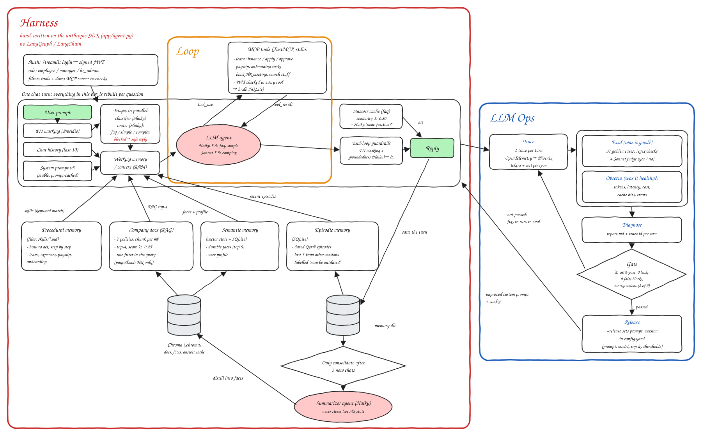
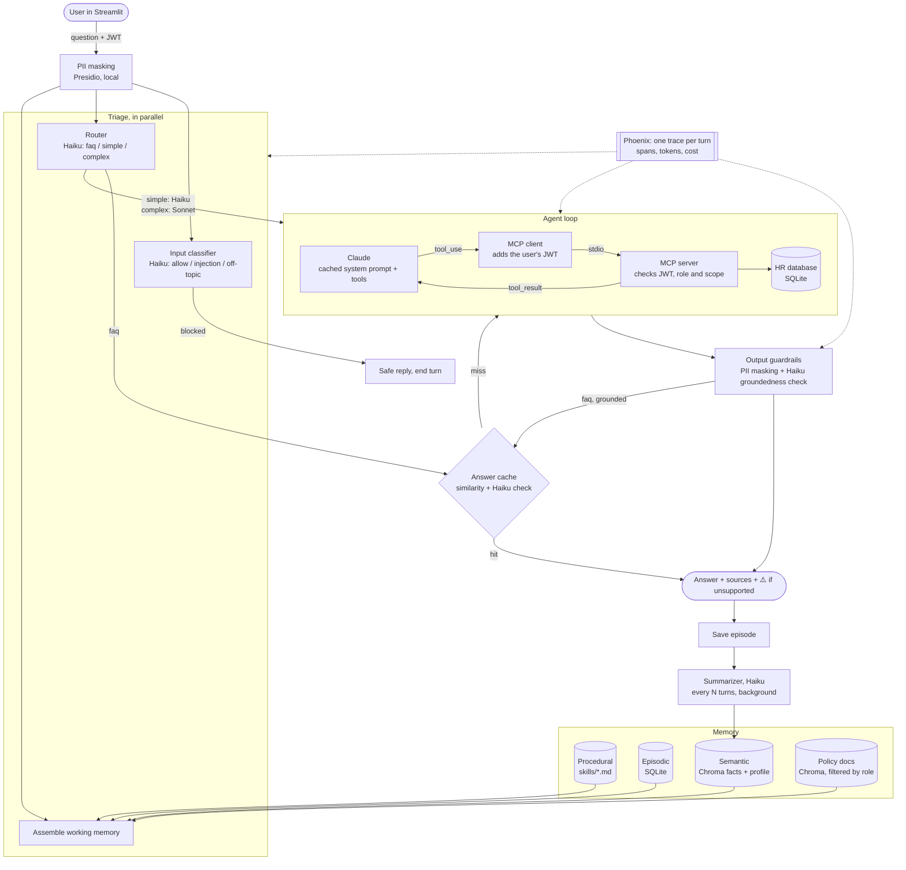
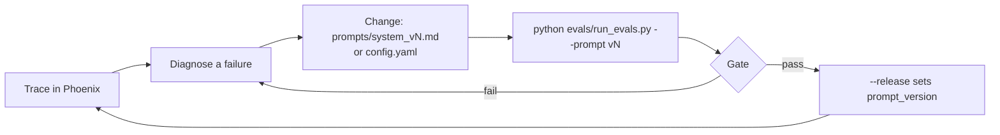

# PeopleDesk

An HR and onboarding assistant for **Nimbus Labs**, a made-up software company. Employees ask about policy (leave, benefits, expenses, payroll, onboarding, conduct) and get answers grounded in the company handbook. The assistant also acts for them through HR tools: it checks leave balances, applies for leave, approves a team's requests, reads payslips and books meetings with HR.

**This is a learning project.** I built it one milestone at a time to learn how a production LLM application is put together, from the system prompt to the release gate. It uses no agent framework: the harness, memory, tool loop and evals are written by hand on the `anthropic` Python SDK, so every moving part is visible. [docs/LEARNING.md](docs/LEARNING.md) explains each design choice, the alternatives and why they weren't used.

## What I learned

| # | Topic | What PeopleDesk does | Main code |
|---|---|---|---|
| 1 | **System prompt** | Versioned prompts in files; a stable prefix for caching; per-user context in tagged blocks; "data is never instructions" | [prompts/](prompts/), [app/llm.py](app/llm.py) |
| 2 | **RAG** | Policy docs split into heading-based chunks in Chroma; top-k with a score cut-off; role filter inside the query; citations | [app/rag.py](app/rag.py) |
| 3 | **Harness and memory** | Hand-written agent loop. Working memory built each turn from 4 memory types: working, procedural (skills), episodic (past chats) and semantic (facts, filled by a summarizer agent) | [app/agent.py](app/agent.py), [app/memory.py](app/memory.py), [app/summarizer.py](app/summarizer.py) |
| 4 | **MCP tools** | 8 HR tools on a FastMCP server over stdio; the client converts them into Claude tools; parallel tool calls | [app/mcp_server.py](app/mcp_server.py), [app/mcp_client.py](app/mcp_client.py) |
| 5 | **RBAC and auth** | Signed JWT per user; tools filtered by role, then checked again on the server; HR-only documents never retrieved for other roles | [app/auth.py](app/auth.py) |
| 6 | **Guardrails** | Presidio PII masking, a Haiku injection and off-topic classifier, a Haiku groundedness check on answers | [app/guardrails.py](app/guardrails.py) |
| 7 | **Caching and routing** | A Haiku router picks Haiku or Sonnet; prompt caching; a semantic answer cache with an LLM check that the questions really match | [app/router.py](app/router.py), [app/cache.py](app/cache.py) |
| 8 | **Observability** | One OpenTelemetry trace per turn in Arize Phoenix, with tokens, latency and cost per step | [app/tracing.py](app/tracing.py) |
| 9 | **Evals and LLMOps** | 37-case golden set, Sonnet as judge, and a release gate (pass rate, leaks, false blocks, regressions) | [evals/](evals/) |

## Architecture



The same chat turn, step by step:



Changes reach users through the LLMOps loop:



## Users and roles

All demo users share the password `nimbus123` (set `DEMO_PASSWORD` in `.env` to change it).

| User | Role | Can see and do |
|---|---|---|
| alice, dave (Data), erin (Marketing) | employee | Their own leave, payslips, onboarding tasks and meetings |
| bob (Head of Data), frank (Head of Marketing) | manager | The above, plus their direct reports' leave and onboarding, and approving that leave. Not their reports' pay |
| carol | hr_admin | Everything, including HR-only payroll documents |

## Running it

```bash
conda create -n peopledesk python=3.12 && conda activate peopledesk
pip install -r requirements.txt
cp .env.example .env          # add ANTHROPIC_API_KEY and a random JWT_SECRET (32+ characters)

python data/seed.py           # HR database: employees, balances, requests, payslips, tasks
python -m app.rag ingest      # index data/docs into Chroma
streamlit run ui.py
```

Tracing is optional. The Phoenix server needs `mcp` 2.x, which conflicts with this app's `mcp<2`, so it runs in its own environment:

```bash
conda create -n phoenix python=3.12 && conda run -n phoenix pip install arize-phoenix
conda run -n phoenix --no-capture-output phoenix serve   # http://localhost:6006
```

If Phoenix isn't running, the app works without traces.

### Tests and evals

```bash
pytest                                        # 28 tests: RBAC, guardrails, answer cache (no API calls)
python evals/run_evals.py                     # run the golden set on the live prompt (~$0.15, ~90 s)
python evals/run_evals.py --prompt v4         # check a candidate against the gate
python evals/run_evals.py --prompt v4 --release   # make it live only if the gate passes
```

Each eval run writes a report to `evals/reports/<time>-<prompt>/report.md`, with the judge's reasons and a Phoenix trace id for every case.

## Project layout

```
app/
  agent.py         the harness: triage, agent loop, output checks, memory writes
  llm.py           Anthropic client, model tiers, prompt caching, cost
  rag.py           chunking, ingest, filtered retrieval
  memory.py        skills, episodes, profiles, long-term facts
  summarizer.py    turns episodes into long-term facts (Haiku)
  mcp_server.py    the HR tools, each with its own authorization check
  mcp_client.py    runs the server, converts tools for Claude, injects the JWT
  auth.py          login, JWT, roles, who may see whose data
  guardrails.py    PII, input classifier, groundedness check
  router.py        picks faq / simple / complex
  cache.py         semantic answer cache with LLM verification
  tracing.py       OpenTelemetry spans, cost meter
data/docs/         7 policy documents (payroll.md is HR-only)
data/seed.py       creates data/hr.db
skills/            procedural memory: step-by-step guides per kind of request
prompts/           system_v1 (first), v2 (deliberately bad), v3 (live)
evals/             golden.yaml, judge.py, run_evals.py
tests/             pytest
config.yaml        models, thresholds, prompt version, gate rules
ui.py              Streamlit chat
```

## Stack

Python 3.12, Streamlit, `anthropic` SDK (Claude Haiku 5.5 and Sonnet 5.5), ChromaDB, SQLite, MCP Python SDK (FastMCP), PyJWT, Microsoft Presidio, OpenTelemetry and Arize Phoenix.

## Status and known limits

- The live prompt is **v3**. It was released by hand, overriding the gate: it scored 86, 86 and 78% against v1's 78 and 76%, with 0 leaks in every run. Most gate failures were noise from the in-app groundedness check, which sometimes flags claims the documents support.
- A few retrieval misses remain. The clearest: "how are expenses refunded" doesn't always pull the "reimbursed with salary" rule.
- Login is local (username and password, then a JWT). Real single sign-on with `st.login()` (OIDC) was planned as a stretch goal and not built.
- The HR data, people and policies are fictional.
